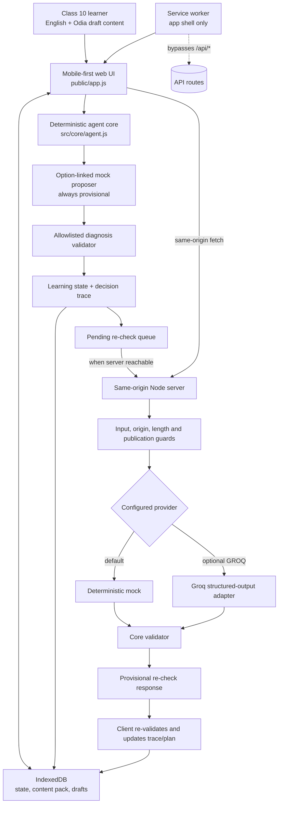

# Pathasetu — as-built MVP architecture

This diagram describes the code currently in this workspace. It is not a claim that the app is phone-tested or educationally validated.

## Important boundaries

- Local submission uses the deterministic mock to keep the learning path available offline. The mock uses the selected option plus an explanation-length check; it does not interpret free-text Odia or English.
- The queued re-check is sent to the server after a reachability probe succeeds. It can use the mock (default) or the optional Groq adapter.
- Both the server and client validate the returned diagnosis against the current item's allowed IDs. The model never writes the learner state directly.
- The answer and current question are preserved while a re-check proposes a next item. The learner explicitly applies the updated recommendation.
- The service worker caches the app shell and shared browser-safe core modules but never caches `/api/*` responses.
- Every current content item and Odia translation is `UNREVIEWED_DRAFT`. No learning outcome, language accuracy, live-provider quality, or real-device support has been validated.
