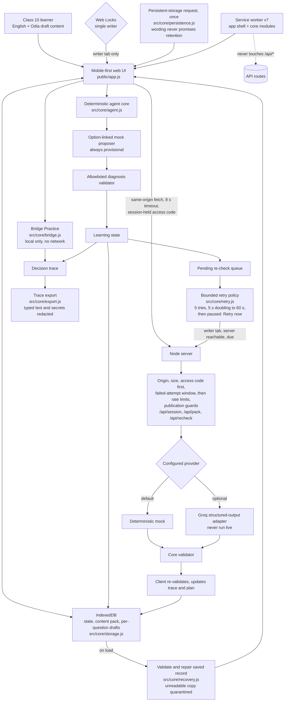

# Pathasetu — as-built MVP architecture

This describes the code in this workspace, not an aspiration. It is not a claim that the app is phone-tested, content-reviewed or educationally validated.

## Boundaries that the tests enforce

- **The model never writes learner state.** The server and the client both validate every diagnosis against the current question's allowed IDs, `NONE` or `UNCERTAIN`. Anything invalid is rejected and the queue entry stays retryable.
- **Only the writable tab writes.** With Web Locks the first tab holds `pathasetu-single-writer`. Any other tab is read-only: it does not save, does not process the queue, and cannot practise. A persistent banner says so. Without Web Locks the app shows a persistent single-tab warning instead.
- **Drafts belong to a question.** `ui.drafts[itemId]` is stored with the record and restored only on that question. Focus and caret are restored after a re-render only when the same question is still shown.
- **One answer, one queue entry.** A second submit for an answered, not-yet-continued question is rejected in the core and ignored in the UI.
- **A stalled provider cannot freeze the queue.** A re-check request is aborted after 8 s, counted as an attempt and retried under the bounded policy below. Repeated failures update one trace line instead of flooding the 200-event trace.
- **Stale references recover.** `reconcileState` replaces a missing current question and clears a recommendation that points at a missing question. Queue entries whose answer or question is gone are dropped with a trace entry.
- **The service worker caches the app shell and the browser-safe core modules only**, never `/api/*`. A static test fails if a core module imported by the browser is missing from the shell.
- **Bridge Practice uses only the current pack.** `src/core/bridge.js` is pure: no network, no randomness, no model. The target is the current question's `bridge` fields; distractors are other distinct mappings that share no term with the target. It is disabled, with a reason, below three distinct mappings. Attempts and reveals are written to the existing decision trace.
- **Draft content is access-controlled.** Whenever the server would send an unreviewed item and `PATHASETU_DEMO_ACCESS_CODE` is set, `/api/pack` needs the same `x-pathasetu-demo-code` header as `/api/recheck`. A refusal contains no pack content. The browser keeps the code in `sessionStorage` only (never IndexedDB, localStorage, URL, logs or the trace export), and discards it only on a 401; a 429 keeps the code and any saved pack and shows a wait message. A production deployment that serves drafts must set the code.
- **Public demo mode is fail-closed.** `src/server/access.js` holds the pure rules shared by the server and `npm run preflight`: `parsePublicDemoFlag` (exactly `true` or `false`, anything else stops startup), `assessAccessCode` (16+ characters, no whitespace, at least 6 distinct characters, not a repeated unit, no sequential run of 8, no placeholder word; it returns category names only, never any part of the value), and `parseAllowedOrigins` (https, or http for loopback; wildcards, paths, queries, credentials, default ports and upper-case hosts refused; credentials masked in the error). With `PATHASETU_PUBLIC_DEMO=true` the server refuses to start without a strong code, independent of provider and `NODE_ENV`, and `/api/session`, `/api/pack` and `/api/recheck` all require it. `/api/health` stays open and reports `provider`, `accessRequired` and `publicDemo` only. This is demo protection, not production authentication.
- **Access is checked before rate limits, and failures have their own bounded window.** On a protected route the code is verified first. A missing or wrong code adds to one per-client counter shared by the three routes (`PATHASETU_FAILED_ATTEMPT_LIMIT`, default 20 per `PATHASETU_RATE_WINDOW_MS`); within the budget the answer is 401, over it `429 too_many_attempts` with `Retry-After`. It is a fixed window that expires without intervention and a correct code never reaches it, so wrong guesses from a shared address cannot lock the right code out and cannot consume the authorised budget. Only authorised requests are then counted against the ordinary per-route limits. Counters are in memory, keyed by socket address, bounded in size and reset on restart. Nothing logs the supplied code.
- **Preflight is a separate, non-networked check.** `scripts/lib/preflight.mjs` validates configuration with the same `access.js` rules, runs the content-consistency checker, and then starts a loopback harness server that is forced to the mock provider with a blank API key, so it can never reach a model provider. It verifies health, session, pack, re-check, refusals for missing and wrong codes, that served item statuses equal the pack file's (no promotion), and the Host-rewriting origin route; output is redacted against the configured secrets.
- **Retries are bounded and recoverable.** `src/core/retry.js` is a pure policy (no timers, no clock): 5 automatic attempts, 5 s base delay doubling to a 60 s cap. After that the entry is paused and flagged `needsAttention`; the answer and the entry are never deleted. A persistent status explains it and **Retry now** resets only the retry fields. Reachability events do not bypass the backoff. State survives reload; a read-only tab shows the status with the button disabled.
- **Storage failure is reported, not hidden.** `src/core/recovery.js` validates a saved record on load and repairs what it can (unknown references, bad shapes, oversize collections, counted and traced without text); an unreadable record is copied to `session-unreadable-backup` rather than deleted. If IndexedDB is unavailable or a write fails after working, the status line and the banner say progress is **not saved to this device**. `navigator.storage.persist()` is requested once after the first saved answer and the outcome is described without promising retention.
- **Trace export carries no secrets and no typed text.** `src/core/export.js` replaces each typed explanation with `{redacted, characters}`, omits drafts, and redacts access codes, API-key patterns, bearer tokens and environment assignments wherever they appear. Export format 2.
- **Origins.** A POST's `Origin` must equal the `Host` the server receives. Behind a Host-rewriting tunnel, exact origins can be listed in `PATHASETU_ALLOWED_ORIGINS` (validated at startup; no wildcards). This does not weaken the access code.

## Test architecture

| Layer | Command | What it covers |
| --- | --- | --- |
| Unit and static | `npm test` | Core, validator, content gates, queue, retry policy, storage resilience and repair, trace export, evaluation tooling, content consistency, accessibility-audit logic, phone-matrix consistency, access policy, public demo mode and throttling, preflight, origin policy, handoff documents, Groq fake-fetch, server, service-worker and UI wiring, Bridge Practice |
| Syntax | `npm run check` | Server, browser app, service worker, core modules and scripts |
| Pre-demo readiness | `npm run preflight` | Configuration safety, content-consistency (not review), local routes through a mock-only harness; exits nonzero on unsafe settings; no provider call |
| Content consistency | `npm run check:content` | Pack integrity, worksheet versus pack, review honesty, evaluation template; never marks anything reviewed |
| Server/API and one browser journey | `npm run capture` | HTTP guards plus the original online, offline, reconnect journey |
| Browser regression | `npm run e2e` | Offline reload, cold start, double submit, focus and caret, stale content, two tabs, service-worker update, provider failures and timeouts, draft reload, Bridge Practice, protected draft demo, throttled access (429 keeps the saved pack and code), bounded retries and manual retry, IndexedDB failure, corrupt and partly corrupt saved state, trace export |
| Accessibility and mobile audit | `npm run a11y` | Names, 44 px targets, keyboard Tab traversal and focus ring, WCAG AA contrast, 12 px minimum text, language tags, overflow and 320 px reflow, across 5 viewports and 7 app states |
| Diagnosis evaluation | `npm run evaluate` | 47 team-authored English cases (`TEAM_AUTHORED_UNVALIDATED`): deterministic baseline always; live provider only with local credentials (BLOCKED otherwise) |

All browser tests drive a real Chromium over the Chrome DevTools Protocol with no extra dependency. Set `CHROME_PATH` to a local Chrome or Chromium. They are not phone tests and the accessibility audit is not a screen-reader test.

## What this architecture does not claim

Every content item and Odia wording is `UNREVIEWED_DRAFT`. The mock does not interpret free text and its agreement figures on the evaluation set describe a rule, not language understanding. The Groq adapter has only run against local fake responses. No physical device has been tested. Nothing is deployed.
