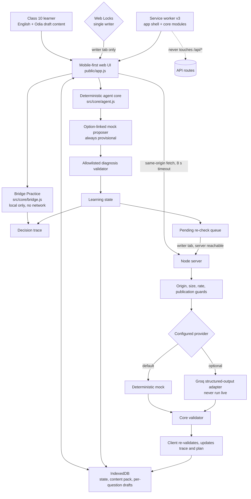

# Pathasetu — as-built MVP architecture

This describes the code in this workspace, not an aspiration. It is not a claim that the app is phone-tested, content-reviewed or educationally validated.

## Boundaries that the tests enforce

- **The model never writes learner state.** The server and the client both validate every diagnosis against the current question's allowed IDs, `NONE` or `UNCERTAIN`. Anything invalid is rejected and the queue entry stays retryable.
- **Only the writable tab writes.** With Web Locks the first tab holds `pathasetu-single-writer`. Any other tab is read-only: it does not save, does not process the queue, and cannot practise. A persistent banner says so. Without Web Locks the app shows a persistent single-tab warning instead.
- **Drafts belong to a question.** `ui.drafts[itemId]` is stored with the record and restored only on that question. Focus and caret are restored after a re-render only when the same question is still shown.
- **One answer, one queue entry.** A second submit for an answered, not-yet-continued question is rejected in the core and ignored in the UI.
- **A stalled provider cannot freeze the queue.** A re-check request is aborted after 8 s, counted as an attempt and retried later. Repeated failures update one trace line instead of flooding the 200-event trace.
- **Stale references recover.** `reconcileState` replaces a missing current question and clears a recommendation that points at a missing question. Queue entries whose answer or question is gone are dropped with a trace entry.
- **The service worker caches the app shell and the browser-safe core modules only**, never `/api/*`. A static test fails if a core module imported by the browser is missing from the shell.
- **Bridge Practice uses only the current pack.** `src/core/bridge.js` is pure: no network, no randomness, no model. The target is the current question's `bridge` fields; distractors are other distinct mappings that share no term with the target. It is disabled, with a reason, below three distinct mappings. Attempts and reveals are written to the existing decision trace.

## Test architecture

| Layer | Command | What it covers |
| --- | --- | --- |
| Unit and static | `npm test` | Core, validator, content gates, queue, Groq fake-fetch, server, service-worker and UI wiring, Bridge Practice |
| Syntax | `npm run check` | Server, browser app, service worker, core, scripts |
| Server/API and one browser journey | `npm run capture` | HTTP guards plus the original online, offline, reconnect journey |
| Browser regression | `npm run e2e` | Offline reload, cold start, double submit, focus and caret, stale content, two tabs, service-worker update, provider failures and timeouts, draft reload, Bridge Practice |

All browser tests drive a real Chromium over the Chrome DevTools Protocol with no extra dependency. Set `CHROME_PATH` to a local Chrome or Chromium. They are not phone tests.

## What this architecture does not claim

Every content item and Odia wording is `UNREVIEWED_DRAFT`. The mock does not interpret free text. The Groq adapter has only run against local fake responses. No physical device has been tested.
