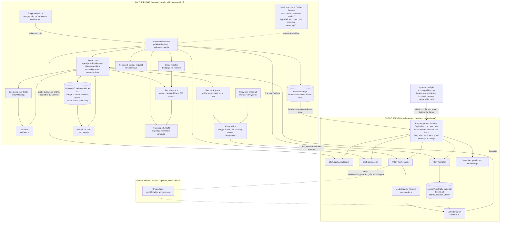

# Pathasetu — as-built system architecture

Written 13 October 2026 from the files in this repository, not from intentions. Every box below exists in the code. Nothing is shown as planned, because nothing planned is drawn. It is **not** a claim that the app is phone-tested, content-reviewed, deployed or educationally validated; those statuses are in `PROJECT_GUIDE_PLAIN_LANGUAGE.md` and `CLAIM_EVIDENCE_MATRIX.csv`.

This is the one component reference. `ARCHITECTURE.md` keeps the list of enforced boundaries and the test layers and points here for the picture, so the two cannot disagree about the diagram.

## 1. The picture

Boxes inside **ON THE PHONE (browser)** run in the learner's browser and keep working with the network off. Boxes inside **ON THE SERVER** run in a Node process that must be reachable. Anything drawn inside **NEEDS THE INTERNET** is outside the team's control and has **never been called live**.

Failure and recovery paths are in the diagram as well as the happy path: *server unreachable* → the probe flips the pill to OFFLINE and the queue waits; *re-check fails, times out, returns invalid JSON or an unapproved ID* → `RP` counts the attempt and schedules the next, up to five, then pauses; *paused* → `MR` (**Retry now**) restarts the cycle; *saved record unreadable* → `RC` repairs or copies it aside and starts fresh; *IndexedDB blocked or a write fails* → memory-only fallback with a visible warning; *second tab* → `WL` makes it read-only.

## 2. Every arrow in plain English

| Arrow | What it means |
|---|---|
| UI → Agent core | When you press **Check my thinking**, `doSubmit()` calls `submitAnswer()`. |
| Agent core → local proposer → validator → Agent core | The agent asks the rule for a proposal. The validator accepts it only if its ID is on the question's allow-list and (for a decision) its confidence is at least 0.65. Only then does the agent store it, marked *provisional*. |
| Agent core → trace / queue | Each decision writes a short event to the trace; each answer adds one entry to the waiting list. |
| Agent core ↔ IndexedDB | After every change `saveRecord()` writes the whole record. On load the saved record is read back. |
| IndexedDB → Repair → Agent core | On load, `repairSavedRecord()` removes unusable parts, keeps valid ones and counts what it changed in the trace. |
| UI → Bridge Practice → trace | The matching exercise is built locally from the pack; each attempt and reveal is written to the trace with `network: false`. |
| UI → persistent-storage request / trace export | After the first saved answer the app asks the browser once to keep its storage; the Download button builds a JSON without typed text. |
| Queue → retry policy → `/api/recheck` | When an entry is due and the server answers the probe, the writer tab posts the item ID, chosen option and typed text. |
| Manual retry → retry policy | **Retry now** clears the paused flag and the failed-attempt count for that entry. |
| UI → `/api/health` | A cheap probe tells the app whether the server is really reachable, which is not the same as the browser saying it is "online". |
| sessionStorage → guards | If the server requires a code, the page sends it in a header with every protected request. |
| Service worker → UI | After one online visit it can serve the page and its scripts with no network. |
| Guards → routes | Every `/api/*` request passes the Origin check first; protected routes then require the code; wrong codes use a shared failed-attempt window; the rest are counted by per-route rate limits. |
| `/api/pack` → pack file | Returns the 8 items (drafts only if the server allows drafts). |
| `/api/recheck` → mock → validator | The default second opinion is the same kind of rule, then validated on the server. |
| `/api/recheck` ⇢ Groq ⇢ validator | Dashed: only if the server was started with `PATHASETU_MODEL_PROVIDER=groq` and a key. Not the default, not run live. |
| Validator → Agent core | The browser validates the server's answer again before changing anything (`recheckQueued`). |
| Preflight ⇢ guards | Laptop tool, not part of the running app. It starts its own loopback server forced to the mock provider. |

## 3. Components in detail

**Failure handling** columns say what the user sees or what the code does. **Tests** names where it is checked (unit file under `tests/`; browser scenario letter in `scripts/browser-regression.mjs`). "Not phone-tested" applies to every row.

| Component | Role | Source file | Input | Output | State it owns | Callers | Failure handling | Tests |
|---|---|---|---|---|---|---|---|---|
| Screen and controls | Show the question, collect choice and text, show results, plan, bridge, progress, trace | `public/index.html`, `public/app.js`, `public/styles.css` | clicks, typing, server replies | DOM, saved record | `ui` object (in memory): pack, state, drafts, flags | the browser | Visible notices and banners for each failure (see `NAVIGATION_AND_WORKFLOW.md`) | `uiStatic.test.js`; e2e A–Z; `a11y` |
| Single-writer lock | Only one tab may write | `public/app.js` `acquireWriterLock` | Web Locks API | `ui.writable` | the lock | `startApp` | No Web Locks: single-tab warning banner | e2e G |
| Agent core | Entry to the loop; planner and executor | `src/core/agent.js` | state, pack, item, option, text, online flag | updated state, answer, queue entry, trace event, next item | `learner`, `answers` (cap 500), `queue` (cap 100), `trace` (cap 200) | `doSubmit`, `drainQueue`, `load` | Duplicate submit rejected (`already_answered_awaiting_continue`); queue full rejected (`recheck_queue_full`); stale IDs replaced by `reconcileState` | `agent.test.js`, `iteration2-core.test.js`; e2e B, C, F |
| Local proposer (rule) | Suggest a diagnosis | `src/core/mockModel.js` | item, option, text | `MISCONCEPTION` (the option's linked ID), `NONE`, or `UNCERTAIN` (text under 8 characters) | none | `submitAnswer`, `recheckQueued`, the server | Unknown option → `UNCERTAIN` | `agent.test.js`, `validator.test.js` |
| Validator | Gate every proposal | `src/core/validator.js` | proposal, item | accepted value or reason | none | agent core, server | Rejects wrong question ID, type, unlisted misconception, bad confidence, rationale over 500 characters, low confidence | `validator.test.js`; e2e J3 |
| Planner (inside agent core) | Choose the next question | `chooseNextItem` in `agent.js` | state, pack, excluded ID, focus concept | one item | none (writes `nextRecommendedItemId`) | `submitAnswer`, `recheckQueued` | No candidate → null | `agent.test.js` |
| Decision trace | Record what and why | `appendTrace` in `agent.js`; view in `renderTrace` | event | newest-first list of 30 shown, 200 kept | `state.trace` | everything | Repeated failure lines are merged so the 200 cap is not flooded | `agent.test.js`; e2e A, K |
| Re-check queue | Waiting list of answers needing a second check | inside `agent.js` | answer | queue entries with attempts, next time, needs-attention flag | `state.queue` | `submitAnswer`, `drainQueue` | Stale entries dropped with a trace line; entries never deleted by failure | `retry.test.js`; e2e D, E, N |
| Retry policy | Decide when to try again | `src/core/retry.js` | entry, clock, policy | schedule or pause | none (pure) | `agent.js`, `app.js` | Paused after 5; **Retry now** resets that entry | `retry.test.js`; e2e N |
| Probe and reachability | Tell real reachability from `navigator.onLine` | `refreshHealth`, `checkHealthOnly` in `app.js` | `GET /api/health` (1.8 s timeout) | `ui.reachable` | `ui.probeDelay` | timers, `online`/`offline`/`visibilitychange` events | Failure → OFFLINE pill, back-off up to 30 s | e2e D, E |
| Local database | Keep progress across reloads | `src/core/storage.js` | the whole record | saved record, quarantine copy | IndexedDB `pathasetu-local-v1` / `records`: keys `session`, `session-unreadable-backup` | `saveRecord`, `load` | Any error → memory-only mode with status text and reason; an unreadable record is copied aside | `storage.test.js`, `storage-resilience.test.js`; e2e P, R |
| Repair on load | Make an old or damaged record safe | `src/core/recovery.js` | saved record, pack | safe state, list of repairs | none | `load` | Never throws; counts, not content, in the trace | `storage-resilience.test.js`; e2e R |
| Persistent-storage request | Ask the browser not to clear data | `src/core/persistence.js` | `navigator.storage` | status text | requester (once per page) | `saveRecord` | Unsupported/denied/error shown without promising retention | `storage-resilience.test.js`; e2e |
| Bridge Practice | Offline matching exercise | `src/core/bridge.js`; UI in `app.js` | pack, item, attempt count | 3 options, one correct | `learner.bridgeAttempts[itemId]` | `renderBridgePractice` | Disabled with a stated reason if the item has no complete mapping or fewer than 3 distinct mappings exist | `bridge.test.js`; e2e K |
| Trace export | Evidence download | `src/core/export.js` | state, provider, storage status | JSON (format 2) with typed text removed and secrets redacted | none | Download button | Redaction patterns for API keys, bearer tokens, code header, known secrets | `storage-resilience.test.js`; e2e S |
| Service worker | Offline shell | `public/sw.js` | requests | cached or live responses | Cache Storage `pathasetu-shell-v7` | the browser | Navigation falls back to the cached `/index.html`; `/api/*` and non-GET are never touched | `uiStatic.test.js`; e2e E1, H1, I1, I2 |
| Server and routes | Serve files, four API routes | `src/server/server.js` | HTTP | files, JSON | in-memory rate counters (per route and socket address, capped at 2048 entries) | the browser | 400/401/403/404/405/413/422/429/502/504 as listed in section 5 | `server.test.js`, `access-policy.test.js`, `public-demo.test.js`, `proxy-origin.test.js`; capture |
| Access control | Demo gate | `src/server/access.js`, `server.js` | `x-pathasetu-demo-code`, `Origin`, `Host` | allow, 401, 403, 429 | failed-attempt window (default 20 per 60 s per client) | routes | Correct code is never refused by the failed-attempt window; counters reset on restart | `access-policy.test.js`, `public-demo.test.js`, `proxy-origin.test.js`; e2e M, T |
| Mock provider (server) | Default second opinion | `mockModel.js` | body of `/api/recheck` | diagnosis | none | `getDiagnosis` | — | `server.test.js`; capture |
| Groq adapter | Optional hosted model | `src/server/groqModel.js` | item, option, text | validated proposal | none | `getDiagnosis` when provider=groq | 5.2 s timeout → 504 `provider_timeout`; non-OK → `provider_request_failed`; strict JSON schema retried non-strict once on a schema 400 | `groqModel.test.js` (fake server only) |
| Content pack | The 8 questions | `content/electricity-pack.json`, `src/core/content.js` | file | validated items | none | server | Invalid pack stops the server at start | `content.test.js`, `content-consistency.test.js` |
| Preflight | Block unsafe demo configs | `scripts/preflight.mjs`, `scripts/lib/preflight.mjs` | environment, flags | PASS/FAIL lines, exit code | none | the operator | Exit 1 on any FAIL; secrets redacted | `preflight.test.js` |

## 4. Where state lives

| Place | What | Lifetime | Leaves the device? |
|---|---|---|---|
| Memory (`ui`) | Loaded pack, current record, flags, timers, focus snapshot | the open tab | no |
| IndexedDB | Saved record, per-question drafts, the pack copy, a quarantined copy of an unreadable record | until the browser clears it (best effort; may be cleared) | no (typed text is sent only in a re-check request, below) |
| sessionStorage | Demo access code | the open tab | only as a request header to the same server |
| Cache Storage | Shell files | until a new service-worker version | no |
| Server memory | Rate counters keyed by socket address | until restart | no |
| Server disk | Nothing learner-related | — | — |

There is **no server-side learner database and no account system**.

## 5. Online and offline data flow, and what is transmitted

**Offline:** answer → local proposer → validator → save → queue entry → trace. Nothing is sent.

**Online:** the same local steps, then `POST /api/recheck` with `{itemId, optionId, explanation}`. The typed explanation (up to 1,000 characters) goes to the Pathasetu server on every re-check. With the default mock provider it goes no further and the server stores nothing. With `PATHASETU_MODEL_PROVIDER=groq` the server forwards the question text, the Odia drafts, the options, the answer key, the selected option and the explanation to `api.groq.com` (`buildBody` in `groqModel.js`, `store: false`); this has **never been done**. The trace export never contains the typed text.

The routes in full:

| Route | Guards | Success | Refusals |
|---|---|---|---|
| `GET /api/health` | Origin check only (open on purpose, the offline probe needs it) | `{ok, provider, model, accessRequired, publicDemo, time}` | 403 `origin_not_allowed` |
| `GET /api/session` | Origin; access code if configured; session rate limit (default 30 per minute) | `{ok, accessRequired}` | 401 `demo_access_required`; 429 `too_many_attempts` or `rate_limited` |
| `GET /api/pack` | Origin; code when the pack is protected (public demo, or drafts served with a code configured); pack rate limit | pack metadata and items (drafts only if allowed: development mode, or `PATHASETU_ALLOW_DRAFT_DEMO=true` in production) | same as above |
| `POST /api/recheck` | Origin; code if configured; re-check rate limit (default 24 per minute); body at most 16 KB; fields checked | `{provider, model, diagnosis, note}` | 400 `invalid_json`/`invalid_request`/`invalid_option`/`explanation_too_long`; 404 `unknown_item`/`content_not_published`; 413; 422 `diagnosis_rejected`; 504 `provider_timeout`; 502 `provider_request_failed` |
| other `/api/*` | Origin | — | 404 `not_found` |
| files | `GET`/`HEAD` only; `public/` and `src/core/*.js` | file with strict CSP, `no-referrer`, `nosniff` | 405, 400 `bad_path`, 404 |

Note for technical-debt questions: the static route serves any `.js` file in `src/core/` (the check is the file-name pattern, not a list), including `content.js`, which the browser never imports. Nothing secret is in those files, and `content/` and `src/server/` are not reachable; the service worker caches only the modules it lists. This has been left unchanged because it is not a defect that exposes data.

## 6. What this architecture does not contain

No accounts or login; no server-side learner storage; no on-device or local language model; no speech input or output; no Kui or other language switch (the HTML is `lang="en"` with Odia spans marked `lang="or"`); no teacher or parent view; no multi-agent orchestration or agent framework; no analytics; no push notifications. The live provider path exists in code but has never been exercised against the real service.

Evidence for the layers (headless Chromium, 13 Oct 2026): `evidence/iteration5/baseline/`.
