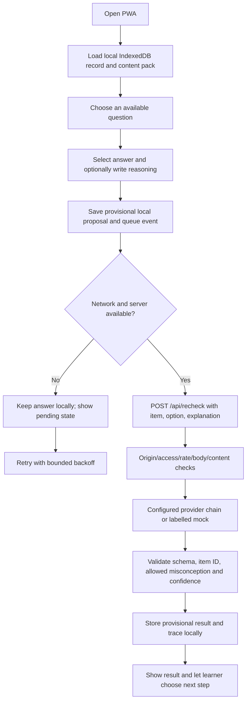
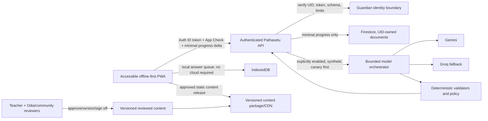

# Pathasetu system upgrade roadmap

**Purpose:** a decision-ready path from the current prototype to a safe, testable learning product. It separates code facts, evidence gaps, and proposed next work so a demo capability is not mistaken for a production feature.

## 1. Current system: code facts

| Layer | Present implementation | Current limit |
|---|---|---|
| Front end | Static HTML/CSS/ES modules in `public/`; responsive styles; service worker shell; local learning dashboard. | No current human-device or assistive-technology verification in this review. The newer dashboard is a prototype shell and contains local draft topic data. |
| Navigation | Overview, draft topics, diagnostic practice, exercise formats, live doubt page (disabled), analytics, local profile switcher. | The Class 1–10/board catalog is not source-verified. Profile labels are local demo state, not identities. |
| Local state | IndexedDB record with answers, pending re-check queue, plan state, trace and local drafts; local family-profile preferences in `localStorage`; shell in Cache Storage. | Browser/device can clear it. Profile data has no cloud backup. Shared-device isolation has not been tested. |
| Backend | Node built-in HTTP server; serves static assets and `/api/health`, `/api/session`, `/api/pack`, `/api/recheck`; origin checks, demo access code where configured, rate limits, request validation and CSP. | No deployed host, production identity, distributed rate limiter, operational alerting, or Firebase project is verified. |
| Learning core | Local deterministic first proposal; bounded queue/retry; response validator; optional server provider chain; bounded next-item planner and trace. | Initial option-linked feedback is not semantic understanding. A validated schema does not prove correct diagnosis or learning gain. |
| Model providers | Provider adapters include Gemini and Groq, configurable by environment in an ordered chain. | No live provider has been called in this workspace review. Exact model IDs, account availability, cost, latency, Odia quality, and response quality remain unknown. The requested runbook does not use Ollama. |
| Content | Eight Class 10 Electricity items in `content/electricity-pack.json`, marked `UNREVIEWED_DRAFT`; broader topic records in `src/core/profiles.js`. | No complete item-to-edition/page crosswalk, teacher sign-off, or Odia-language sign-off. External book download/ingestion was removed. See `CURRICULUM_CONTENT_AUDIT.md`. |
| Cloud and data | Optional Google guardian sign-in and direct Firestore progress-sync code plus strict Rules are present. Web config is incomplete, Rules are not deployed, and no emulator/live sync is verified. | Do not enter real learner/child data. Setup and acceptance gates are in `FIREBASE_SETUP.md`; provider requests should use synthetic explanations only. |
| Agentic AI | A bounded application workflow can ask a provider for a diagnosis/plan and validate the proposal. | There is no multi-agent system, autonomous tool use, external-source retrieval pipeline, teacher approval service, or agent sandbox. “Agentic” means only the present bounded orchestration, not autonomous control. |

## 2. End-to-end workflow

The network request can transmit the learner's typed explanation to the server and configured hosted model. The UI now discloses that transfer and instructs demo users to enter synthetic text only. A model result remains provisional. Content, language and educational validity are separate human-review gates.

## 3. Recommended target architecture

Keep learning-data sync and model inference as separate routes and policies. Firestore should not be used as a generic object store for prompts, raw conversations, or textbook copies. A guardian identity should own access; a learner profile should be pseudonymous. Keys stay on the backend. Rules and IAM must be designed before data is written. Firebase service choices and gates are specified in `FIREBASE_ARCHITECTURE.md`.

## 4. Phased roadmap, dependencies and decision gates

### Phase A — Make the demo truthful and safe (underway)

- Keep the no-account local demo and remove misleading registration/cloud claims.
- Preserve offline state; do not delete service-worker caches during UI rendering.
- Mark topic, answer-key and Odia material as drafts; keep one clearly named demonstration topic.
- Route only diagnostic requests through the configured Gemini/Groq backend; keep the mock label distinct.
- Require explicit synthetic-only disclosure wherever typed reasoning can leave the device.

**Gate:** static syntax check is clean; then browser flow must verify online/offline, update, reset, protected API and local persistence before presenting the build. This review did not run browser checks.

### Phase B — Establish content trust

- Create an item register with stable item ID, target learner outcome, concept, source authority, board, academic year, book title/edition, chapter/page, key rationale, distractor misconception, Odia source/translation, review status and reviewer/date.
- Check every Class 10 Electricity item independently against the official syllabus and the permitted textbook edition. Source presence alone is not alignment.
- Obtain a subject teacher and fluent Odia reviewer; include community review for dialect, register and oral/written language choices.
- Keep generated questions outside the shipped package until approved; publish immutable content versions with corrections and withdrawal support.
- Do not bulk copy or host copyrighted textbooks. Use links/metadata only where permitted; get written permission for reuse beyond applicable terms.

**Gate:** every shipped question has traceable sources and two-role review; answer keys are independently verified; accessibility and age-fit are recorded.

### Phase C — Prove the learning loop

- Fix one board, one class, one topic, and one release pack for the first pilot.
- Document the algorithm: candidate misconception set, evidence required, confidence calibration, abstention, retries, planner constraints, queue idempotency, and learner override.
- Keep model proposals separate from deterministic checks; make “I am not sure” a normal outcome.
- Evaluate with teacher-labelled synthetic cases, ambiguous/incorrect explanations, code-switching, Odia orthography variants, prompt injection and empty-input cases.
- Measure agreement, per-class/per-language precision and recall, abstention quality, false-confidence rate, latency, cost and failure behavior. Do not use completion count as learning gain.

**Gate:** agreed thresholds are set before provider comparison; reviewers sign the evaluation set; no provider is called “accurate” unless it meets the pre-registered thresholds.

### Phase D — Secure Gemini/Groq operation

- Select primary/fallback order and specific model IDs from each account's current supported-model list.
- Call providers only from the backend; move deployed keys to Secret Manager; redact errors/logs; add per-user/IP rate and spend limits, request timeouts, circuit-breaker behavior and idempotency.
- Use provider-specific data controls; confirm whether prompts are retained or reviewed under the selected plan. Use synthetic data until privacy review clears learner data.
- Record provider/model/release/version and evaluation outcome without storing raw explanation text by default.

**Gate:** account/key access verified locally; synthetic canary exercises success, timeout, invalid JSON, 429, fallback and cost ceilings. No key is sent in chat or committed.

### Phase E — Guardian identity and cloud progress (only if field research needs it)

- Choose guardian authentication method and recovery model; implement real token verification, revocation, sign-out and account deletion.
- Start Firestore with deny-all rules, an emulator suite, UID-owned documents, field allowlists, schema versioning, minimal event records, retention/deletion and tested conflict resolution.
- Keep Firestore persistent web cache off initially because the app is meant for shared/low-cost devices; test a shared-device sign-out/profile switch before considering persistent cloud cache.
- Add App Check as an abuse signal, not an authorization substitute. Separate end-user Auth rules from backend IAM when using server credentials.
- Avoid Storage, Analytics, Remote Config and push messaging unless a named learner need and data policy justify each.

**Gate:** development project only, Firebase Rules Emulator tests, two-device offline/online reconciliation, account deletion/export, shared-phone leakage checks, cost alerts, and approved data handling.

### Phase F — Field readiness and release

- Test low-end Android phones, low bandwidth, offline/reconnect, Chrome/Firefox/Safari variants, keyboard/screen reader, zoom, Odia fonts/input and assistive technology.
- Run classroom observations with voluntary adult-managed consent; observe where learners misunderstand, hesitate, or prefer oral support. Ask community language reviewers which Kui dialect/script/audio approach they endorse before adding Kui.
- Add support procedures, content takedown, model rollback, data deletion verification, incident response and release ownership.
- Promote a content/provider version only after review gates; retain rollback and status transparency.

**Gate:** pilot sign-off from educators, community/language reviewers, privacy/legal adviser, accessibility reviewer, and operations owner. No deployment or compliance claim is inferred from this repository review.

## 5. Improvement choices and trade-offs

| Recommendation | Advantage | Cost / risk | Decision status |
|---|---|---|---|
| One verified class/topic first | Makes review, testing and demo claims tractable. | Slower breadth; other class catalog remains draft. | Recommended. |
| Local-first progress, optional guardian sync later | Works without network and avoids cloud dependence. | No cross-device recovery until sync is built. | Current local baseline; sync not implemented. |
| Gemini primary + Groq fallback (or reverse after evaluation) | Avoids single-provider dependency; both requested providers are supported. | Different output quality, latency, data terms, rate limits, structured-output behavior and cost. | Provider order/model IDs await account-specific validation. |
| Bounded model proposals + deterministic validation | Reduces malformed/out-of-scope output and keeps learner control. | Validators cannot prove educational truth; confidence numbers can mislead if uncalibrated. | Existing architecture pattern; thresholds still need evidence. |
| Static approved content packages | Predictable offline behavior and versioned review; fewer runtime model risks. | Content updates require release/version rollout. | Recommended before remote ingestion. |
| Firebase for only Auth + minimal progress | Supports guardian-owned cross-device continuity with rules and UID boundaries. | Adds child-data governance, cost, migration, shared-device and deletion complexity. | Candidate, gated by field need. |
| No multi-agent autonomy for MVP | Smaller attack surface; easier audit and deterministic replay. | Less automation for editorial work. | Recommended; AI may draft, humans publish. |

## 6. Open questions that block irreversible choices

1. Which provider order should the live chain use: Gemini first then Groq, or Groq first then Gemini?
2. Which Firebase sign-in method should guardians use, if field research confirms cross-device sync is needed?
3. Which official BSE Odisha academic-year syllabus and exact permitted textbook edition/page should anchor the demo pack?
4. Which Odia teacher/community reviewers will approve script, dialect/register and content? For Kui, which community-preferred written/oral forms should be supported?
5. What retention and deletion period should apply to guardian accounts and learner progress? This needs owner and privacy/legal review, not a code assumption.

## 7. External primary sources checked

- Firebase's Firestore web offline persistence documentation says persistence is disabled by default on web and cached data is not automatically cleared between sessions: <https://firebase.google.com/docs/firestore/manage-data/enable-offline>.
- Firebase's Firestore rules documentation explains `request.auth.uid` ownership checks and that server SDKs bypass Firestore Security Rules in favor of IAM: <https://firebase.google.com/docs/firestore/security/rules-conditions>.
- Firebase Functions can bind secrets from Secret Manager to only the functions that need them: <https://firebase.google.com/docs/functions/config-env>.
- NCERT's textbook service states its digital textbooks are copyrighted and may not be republished as digital-content packages without permission: <https://ncert.nic.in/textbook.php/textbook/textbook/textbook/textbook.php>.
- The official BSE Odisha Class X General Science PDF for 2026–27 lists Electricity under Physical Science; this supports a topic-level mapping only, not question-level/book-page alignment: <https://bseodisha.nic.in/wp-content/uploads/2026/05/Subject_wise_syllabus_class_X_26_27.pdf>.
- Gemini's current model guide lists `gemini-3.8-flash`; Groq directs developers to its live model listing because model availability changes. Verify both against the actual accounts before use: <https://ai.google.dev/gemini-api/docs/models>, <https://console.groq.com/docs/models>.
